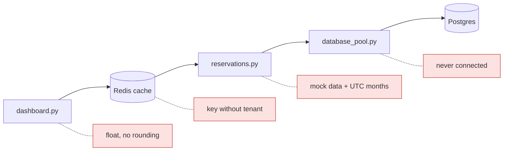

# Property Revenue Dashboard: bug fixes

Fixes for the three issues clients reported on the multi-tenant revenue dashboard, made without rebuilding the system.

## Bugs fixed

| Reported | Root cause | Fix |
|----------|------------|-----|
| **Ocean sees another company's revenue** | The DB connection never worked, so the API served hardcoded mock data that ignored the tenant. The cache key had no tenant either. | Fixed the DB pool, removed the mock, and scoped every query and cache key by tenant. Another tenant's property returns 404. |
| **Sunset's March totals are wrong** | Months were cut in UTC, so a check-in at 00:30 on 1 March in Paris was counted in February. | Months are computed in the property's time zone (DST-safe). |
| **Totals off by a few cents** | Amounts with 3 decimals were converted to float with no rounding rule. | Exact Decimal sums, rounded once to the cent. |

| Seed data | Before | After |
|---|---|---|
| Sunset, prop-001 | 1000.00 (mock) | **2250.00** |
| Ocean, prop-002 (Sunset's property) | 4975.50 | **404** |
| Database down | fake numbers | **503** |



## Run

```bash
docker-compose up --build                        # app :3000 · API :8000/docs
cd backend && uv sync && uv run pytest -v -rs    # 31 tests (DB tests skip if Postgres is down)
```

## Decisions

- "March" means the property's local month: that's how clients keep their books.
- Fail loudly with a 503 rather than show fake numbers.
- Return 404, not 403, for another tenant's property, so the response doesn't reveal that it exists.
- Only the revenue path was changed; auth, the UI and the legacy code are untouched.

## Not done yet

- Unknown users default to Sunset in the tenant resolver. That's auth code, out of scope, and the biggest remaining risk.
- If Redis is down, the endpoint returns 500.
- The UI lists every property for every tenant.

## How I used Claude Code

I made the decisions and wrote them down first. Claude Code reviewed my notes, helped polish the specs, and generated the code and tests, which I reviewed before committing.
